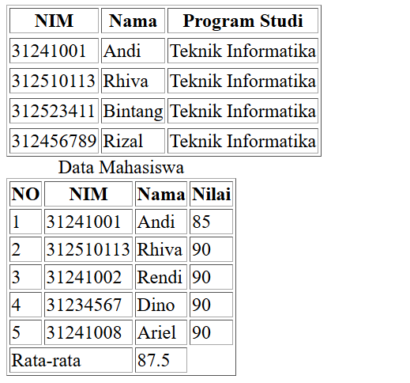
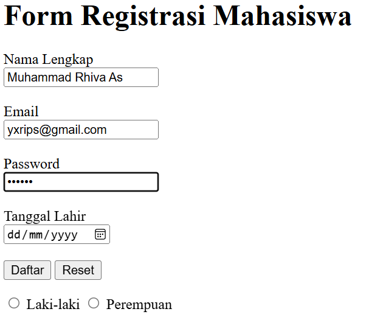
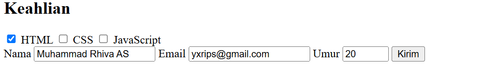
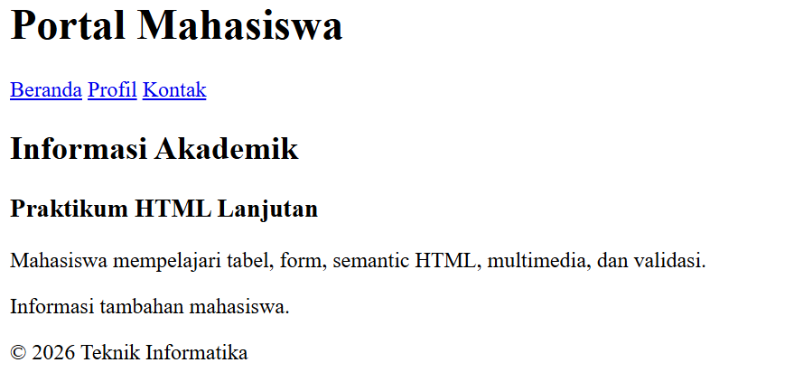
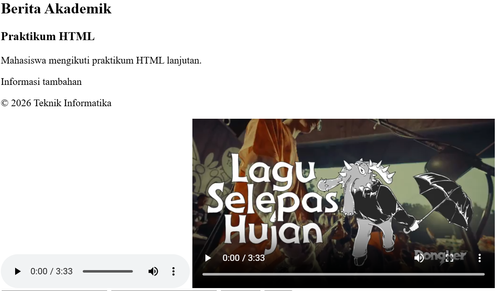
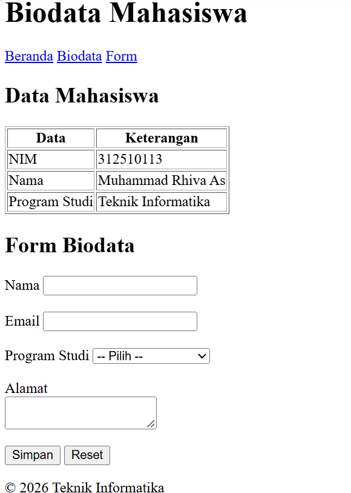

# Lab2Web

Repository ini dibuat untuk memenuhi tugas Praktikum 2
mata kuliah Pemrograman Web.

## Identitas Mahasiswa

- **Nama:** Muhammad Rhiva As
- **NIM:** 312510113
- **Program Studi:** Teknik Informatika

## Deskripsi Praktikum

Praktikum ini bertujuan untuk mempelajari dasar-dasar HTML,
mulai dari pembuatan tabel, form, elemen semantik HTML,
multimedia, validasi form, hingga pembuatan halaman biodata
mahasiswa sebagai proyek mini.

## Langkah-Langkah Praktikum

### 1. Membuat Tabel HTML

Membuat tabel data mahasiswa yang berisi NIM, nama,
program studi, dan nilai mahasiswa. Praktik ini juga
mencakup penggunaan caption, thead, tbody, tfoot,
serta colspan.

### 2. Membuat Form Registrasi Mahasiswa

Membuat form registrasi yang terdiri dari input nama,
email, password, tanggal lahir, pilihan jenis kelamin,
dan checkbox keahlian.

### 3. Menerapkan Validasi Form

Menambahkan validasi HTML menggunakan atribut required,
minlength, min, max, dan tipe input email agar data
yang dimasukkan sesuai dengan ketentuan.

### 4. Menggunakan Semantic HTML

Mempelajari elemen semantic HTML seperti header, nav,
main, section, article, aside, dan footer untuk
menyusun struktur halaman web.

### 5. Menambahkan Multimedia

Menambahkan elemen audio dan video menggunakan tag
audio, video, dan source untuk menampilkan media
pada halaman web.

### 6. Membuat Form dengan Berbagai Input

Membuat form yang menggunakan input teks, email,
textarea, select, serta tombol submit dan reset.

### 7. Membuat Proyek Mini Biodata Mahasiswa

Membuat halaman biodata mahasiswa yang berisi tabel
identitas, navigasi halaman, form biodata, pilihan
program studi, alamat, serta tombol simpan dan reset.

## Teknologi yang Digunakan

- HTML5
- Visual Studio Code
- Web Browser
- Git dan GitHub

## Screenshot Hasil Praktikum

Screenshot hasil pengerjaan setiap latihan dan proyek
mini dapat dilihat pada bagian berikut.

### 1. Tabel Data Mahasiswa

### 2. Form Registrasi Mahasiswa

### 3. Validasi Form dan Keahlian

### 4. Semantic HTML

### 5. Multimedia Audio dan Video

### 6. Proyek Mini Biodata Mahasiswa

## Kesimpulan

Melalui Praktikum 2, mahasiswa mempelajari penggunaan
berbagai elemen HTML untuk membuat tabel, form, struktur
halaman semantik, multimedia, validasi input, serta
halaman biodata mahasiswa.

Praktikum ini menjadi dasar dalam membangun halaman web
yang terstruktur menggunakan HTML5.
